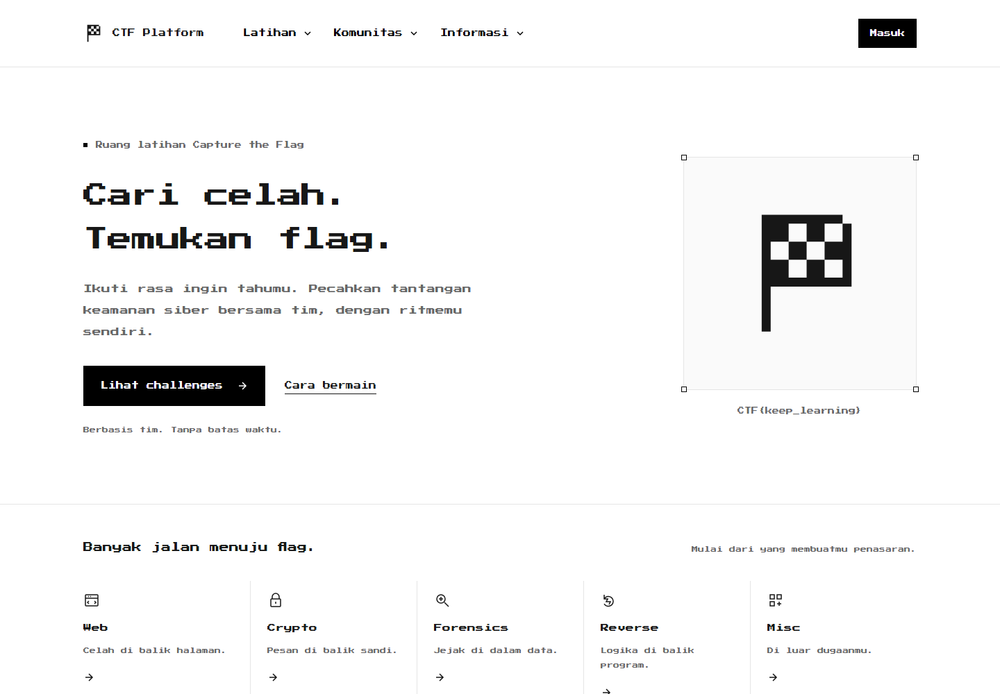
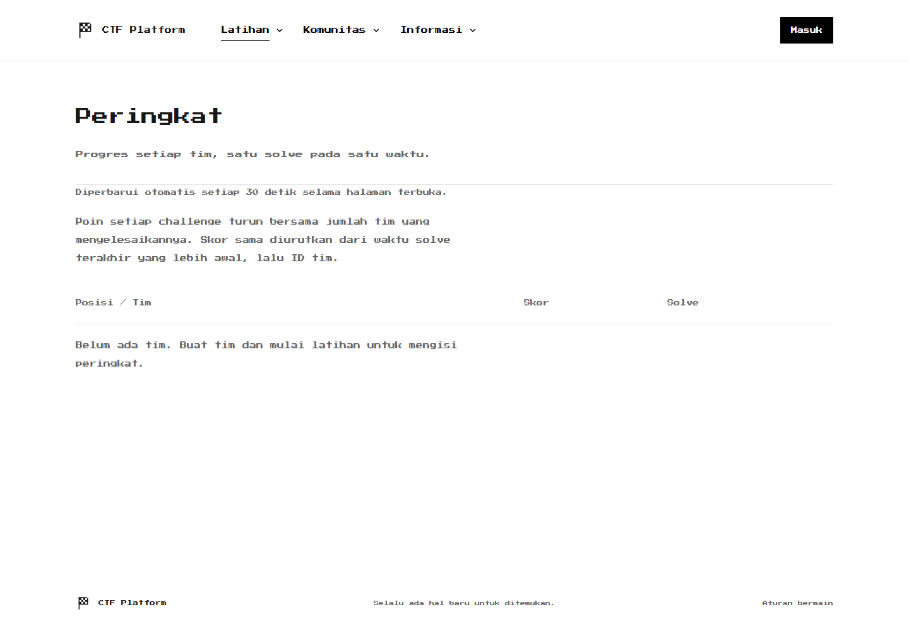
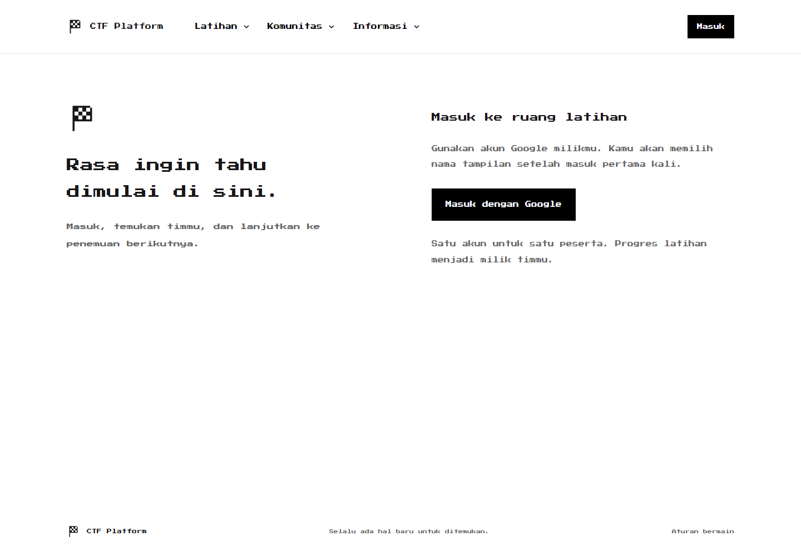

# CTF Platform

Platform latihan Capture the Flag (CTF) berbasis tim dengan login Google,
challenge keamanan siber, pengiriman flag, peringkat, dan panel panitia.
Dibangun dengan vinext, React, TypeScript, dan Cloudflare Workers.

## Instalasi

Gunakan Node.js 22.18+ dan npm. Dari direktori proyek, jalankan:

```sh
npm ci
npm run cf-typegen
npm run db:migrate:local
npm run auth:setup
```

Isi `GOOGLE_CLIENT_ID`, `GOOGLE_CLIENT_SECRET`, dan `ORGANIZER_EMAILS` di
`.dev.vars`. Secret aplikasi dibuat otomatis oleh `auth:setup`.
Daftarkan redirect URI Google OAuth:
`http://localhost:5173/api/auth/callback/google`.
Jika OAuth masih dalam mode testing, tambahkan akun ke daftar test users.

```sh
npm run dev -- --host localhost --port 5173 --strictPort
```

Buka [localhost:5173](http://localhost:5173).
Untuk produksi, lihat [panduan deployment](docs/DEPLOYMENT.md).

## Screenshots

**Beranda**



**Peringkat**



**Login**


